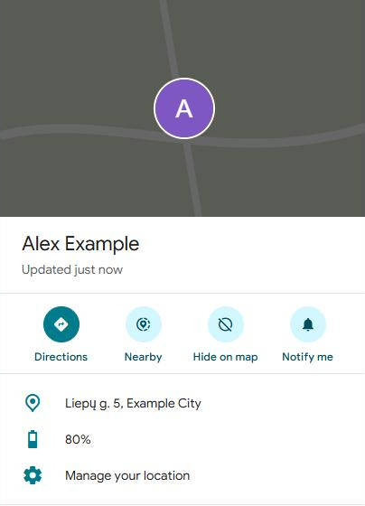
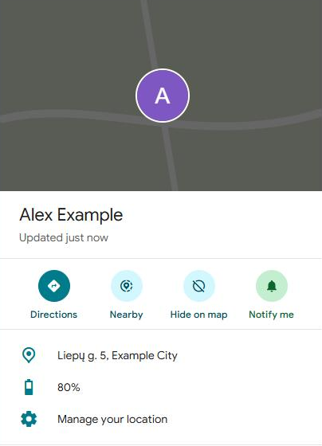
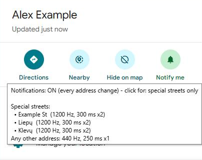

# Google Maps – shared location "Notify me"

A [Tampermonkey](https://www.tampermonkey.net/) userscript for **Google Maps on the web**. In the panel of a person who shares their location with you, it adds a **Notify me** button next to *Directions / Nearby / Hide on map*. When the address shown in that panel changes, the script beeps. Different streets can have different tones.

| Off | Every address change | Special streets only |
|---|---|---|
|  |  |  |

Hover over the button to see the current mode and the configured streets:



> Screenshots are from real Google Maps, with the person's name, photo, address and other details replaced by fake values (display only). The tooltip is the button's native hover text, redrawn so it shows up in a screenshot.

## Install

1. Install the [Tampermonkey](https://www.tampermonkey.net/) browser extension.
2. Open the raw script, and Tampermonkey offers to install it:
   **[maps-location-notify.user.js](https://raw.githubusercontent.com/JeMasLT/gmaps-location-notify/main/maps-location-notify.user.js)**
   Or create a new script in Tampermonkey (*Create a new script…*) and paste in the file's contents.
3. Open [Google Maps](https://www.google.com/maps), go to *Location sharing* and click a person.

> Edit the configuration (below) in your installed copy. Tampermonkey's auto-update would overwrite your changes, so turn off *Check for updates* for this script in Tampermonkey after you customise it.

## Usage

Each click on the **Notify me** button moves to the next mode:

| Button | Mode | Behaviour |
|---|---|---|
| Blue (default) | **Off** | No sounds. |
| Green | **Every change** | Beeps on every address change. Addresses on a special street use that street's tone, all others use `DEFAULT_TONE`. |
| Yellow | **Special streets only** | Beeps only when the new address is on a street from `TONE_RULES`. |

- The address shown when you switch the button on is the starting point and makes no sound.
- If you open another person, or the panel stays closed for longer than `PANEL_LOST_MS`, notifications switch off.
- The click on the button also unlocks audio in the browser (browsers block sound until you interact with the page).
- Open DevTools (F12 → Console) to see `[NotifyMe]` log lines: mode changes, each address change, and the tone used.
- To test a tone without waiting for a real move, type this in the console:

  ```js
  NotifyMeTest('Liepų g. 5, Example City')   // plays the tone this address would get and returns it
  ```

## Configuration

The settings are in the `SETTINGS` block at the top of the script:

```js
// Beep used when the new address matches none of the rules below.
const DEFAULT_TONE = { freq: 440, durationMs: 250, repeat: 1 };

// First matching rule wins. Names match as "contains", ignoring case and accents.
const TONE_RULES = [
  { names: ['Example St', 'Liepų', 'Klevų'], freq: 1200, durationMs: 300, repeat: 2 },
  // { names: ['Ąžuolų'], freq: 800, durationMs: 200, repeat: 3 },
];

const VOLUME = 0.3;         // 0.0 – 1.0
const GAP_MS = 150;         // pause between repeated beeps
const PANEL_LOST_MS = 3000; // panel gone this long -> notifications switch off

// Google Maps UI texts (English UI). Change these if Maps is in another language.
const UI = {
  hideOnMapAria: 'Hide on map',
  addressAria: 'Address',
  buttonLabel: 'Notify me',
};
```

- **`TONE_RULES`**: replace the example streets with your own. `'Liepų'` matches `Liepų g. 12`, `LIEPU G. 12` and so on. Add more rules to give other streets a different tone.
- **`UI`**: the script finds the panel through Google's `aria-label` texts. If your Google Maps is not in English, set `hideOnMapAria` and `addressAria` to the labels your language uses (find them in DevTools: right-click the *Hide on map* button → *Inspect*).

## Tone tester

[`tone-tester.html`](tone-tester.html) is a small standalone page for trying out `freq`, `durationMs`, `repeat`, gap and volume before you put them into the script. Download it and open it in a browser.

## Limitations

- **The Maps tab must stay open.** The script only runs inside the Google Maps page in your browser. It is not a background service and sends no push notifications.
- **Background tabs are throttled.** Browsers slow down timers in background tabs, and Maps may refresh the location less often there, so a beep can come late. A separate, visible Maps window works best.
- **It depends on Google Maps' page structure.** It looks for the *Hide on map* button and the *Address* icon by their `aria-label`. If Google changes the page, the button may disappear until the selectors are updated.
- **The address is the one Maps shows.** It's a street-level text, not exact coordinates, so small moves may not change it, and the address can jump between neighbouring streets.

## Disclaimer

This is an unofficial userscript, not affiliated with or endorsed by Google. Google Maps is a trademark of Google LLC. Use it only with people who have chosen to share their location with you.

## License

[MIT](LICENSE)
