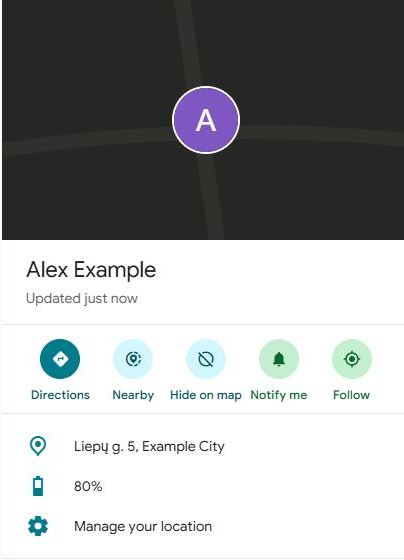
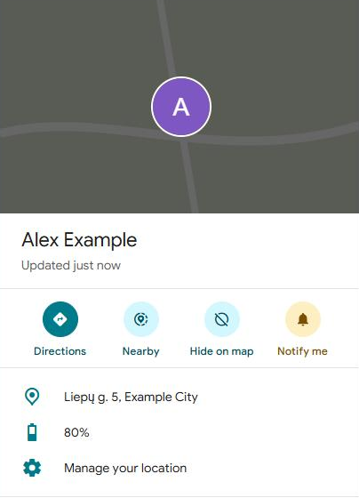

# Google Maps – shared location "Notify me" & "Follow"

A [Tampermonkey](https://www.tampermonkey.net/) userscript for **Google Maps on the web**. In the panel of a person who shares their location with you, it adds two buttons next to *Directions / Nearby / Hide on map*:

- **Notify me**: beeps when the address shown for that person changes. Different streets can have different tones.
- **Follow**: keeps the map centred on the person as they move.



## Features

- 🔔 **Notify me** with three modes: off, beep on every address change, or beep only on the streets you choose.
- 🎵 **Tones per street**: pitch, length and number of beeps for each group of streets (`TONE_RULES`). Matching ignores case and accents.
- 💬 **Tooltip** on the button listing the current mode and every configured street with its tone.
- 🎯 **Follow** re-centres the map on the person whenever their address changes. No page reload, and *Notify me* keeps working.
- 🛑 **Auto-off**: both buttons switch off when you open another person or close the panel.
- 🧪 [**Tone tester**](tone-tester.html): a standalone page to try out beep settings by ear.

## What's new

| Version | Changes |
|---|---|
| **1.2.0** | New **Follow** button: keeps the map centred on the person (re-centres on each address change, at most every `FOLLOW_MIN_INTERVAL_MS`). New settings `FOLLOW_MIN_INTERVAL_MS`, `UI.menuAria` and `UI.followLabel`. |
| **1.1.0** | First public release: 3-mode **Notify me** button, tones per street (`TONE_RULES`), tooltip with the street list, tone tester page. |

## Notify me modes

| Off | Every address change | Special streets only |
|---|---|---|
|  |  |  |

Hover over the button to see the current mode and the configured streets:


> Screenshots are from real Google Maps, with the person's name, photo, address and other details replaced by fake values (display only). The three mode screenshots were taken before the *Follow* button existed. The tooltip is the button's native hover text, redrawn so it shows up in a screenshot.

## Install

1. Install the [Tampermonkey](https://www.tampermonkey.net/) browser extension.
2. Open the raw script, and Tampermonkey offers to install it:
   **[maps-location-notify.user.js](https://raw.githubusercontent.com/JeMasLT/gmaps-location-notify/main/maps-location-notify.user.js)**
   Or create a new script in Tampermonkey (*Create a new script…*) and paste in the file's contents.
3. Open [Google Maps](https://www.google.com/maps), go to *Location sharing* and click a person.

> Edit the configuration (below) in your installed copy. Tampermonkey's auto-update would overwrite your changes, so turn off *Check for updates* for this script in Tampermonkey after you customise it.

### Updating to a new version

- **Never customised it:** in Tampermonkey's dashboard, open the script and use *Check for updates* (or just open the raw link above again).
- **Customised it:** copy your `SETTINGS` block (`TONE_RULES`, tones, volume and so on) somewhere safe, install the new version, then paste your settings back. New settings in the new version (see *What's new*) keep their default values.

## Usage

Each click on the **Notify me** button moves to the next mode:

| Button | Mode | Behaviour |
|---|---|---|
| Blue (default) | **Off** | No sounds. |
| Green | **Every change** | Beeps on every address change. Addresses on a special street use that street's tone, all others use `DEFAULT_TONE`. |
| Yellow | **Special streets only** | Beeps only when the new address is on a street from `TONE_RULES`. |

- The address shown when you switch the button on is the starting point and makes no sound.
- If you open another person, or the panel stays closed for longer than `PANEL_LOST_MS`, notifications switch off.
- The click on the button also unlocks audio in the browser (browsers block sound until you interact with the page).
- Open DevTools (F12 → Console) to see `[NotifyMe]` log lines: mode changes, each address change, and the tone used.
- To test a tone without waiting for a real move, type this in the console:

  ```js
  NotifyMeTest('Liepų g. 5, Example City')   // plays the tone this address would get and returns it
  ```

### Follow (keep the map centred)

A second button, **Follow** (target icon), keeps the map centred on the person. It is independent of *Notify me*, so you can use either one or both. Off is blue, on is green.

- Click it once: it turns green and centres the map on the person right away. Click again to turn it off.
- While it's on, the map re-centres each time the person's address changes, at most once every `FOLLOW_MIN_INTERVAL_MS` (10 s by default).
- Google Maps on the web has no "follow" mode, so the script does what you would do by hand: *Menu → Location sharing → click the person*. The page doesn't reload and *Notify me* keeps working, but you'll see the panel flicker briefly, and the zoom resets to Maps' default for that person.
- Like *Notify me*, it switches off when you open another person or close the panel.

## Configuration

The settings are in the `SETTINGS` block at the top of the script:

```js
// Beep used when the new address matches none of the rules below.
const DEFAULT_TONE = { freq: 440, durationMs: 250, repeat: 1 };

// First matching rule wins. Names match as "contains", ignoring case and accents.
const TONE_RULES = [
  { names: ['Example St', 'Liepų', 'Klevų'], freq: 1200, durationMs: 300, repeat: 2 },
  // { names: ['Ąžuolų'], freq: 800, durationMs: 200, repeat: 3 },
];

const VOLUME = 0.3;         // 0.0 – 1.0
const GAP_MS = 150;         // pause between repeated beeps
const PANEL_LOST_MS = 3000; // panel gone this long -> everything switches off
const FOLLOW_MIN_INTERVAL_MS = 10000; // Follow re-centres the map at most this often

// Google Maps UI texts (English UI). Change these if Maps is in another language.
const UI = {
  hideOnMapAria: 'Hide on map',
  addressAria: 'Address',
  menuAria: 'Menu',
  buttonLabel: 'Notify me',
  followLabel: 'Follow',
};
```

- **`TONE_RULES`**: replace the example streets with your own. `'Liepų'` matches `Liepų g. 12`, `LIEPU G. 12` and so on. Add more rules to give other streets a different tone.
- **`UI`**: the script finds the panel through Google's `aria-label` texts. If your Google Maps is not in English, set `hideOnMapAria`, `addressAria` and `menuAria` to the labels your language uses (find them in DevTools: right-click the *Hide on map* button → *Inspect*).

## Tone tester

[`tone-tester.html`](tone-tester.html) is a small standalone page for trying out `freq`, `durationMs`, `repeat`, gap and volume before you put them into the script. Download it and open it in a browser.

## Limitations

- **The Maps tab must stay open.** The script only runs inside the Google Maps page in your browser. It is not a background service and sends no push notifications.
- **Background tabs are throttled.** Browsers slow down timers in background tabs, and Maps may refresh the location less often there, so a beep can come late. A separate, visible Maps window works best.
- **It depends on Google Maps' page structure.** It looks for the *Hide on map* button and the *Address* icon by their `aria-label`. If Google changes the page, the button may disappear until the selectors are updated.
- **Follow drives the Maps UI.** It opens *Menu → Location sharing* and clicks the person, so it depends on that menu item and list. If Maps changes them, re-centring fails and a `[NotifyMe] Re-centre failed: …` line appears in the console.
- **The address is the one Maps shows.** It's a street-level text, not exact coordinates, so small moves may not change it, and the address can jump between neighbouring streets.

## Disclaimer

This is an unofficial userscript, not affiliated with or endorsed by Google. Google Maps is a trademark of Google LLC. Use it only with people who have chosen to share their location with you.

## License

[MIT](LICENSE)
